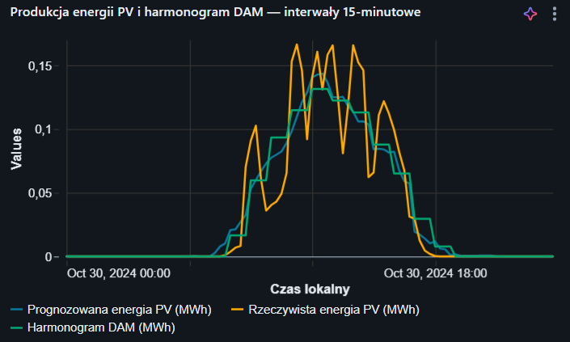
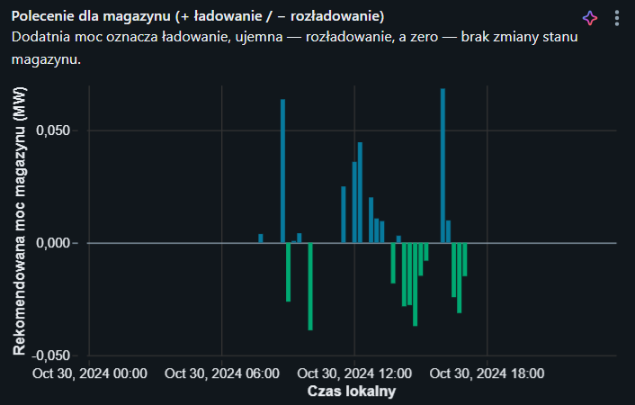
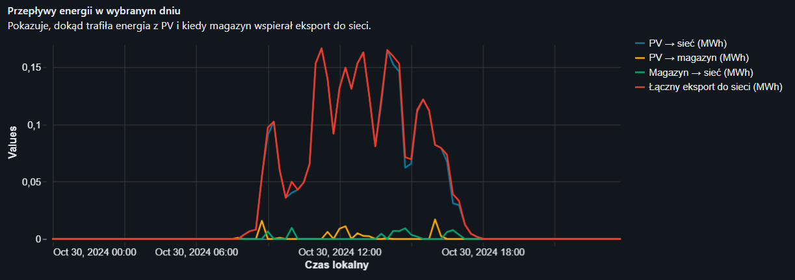
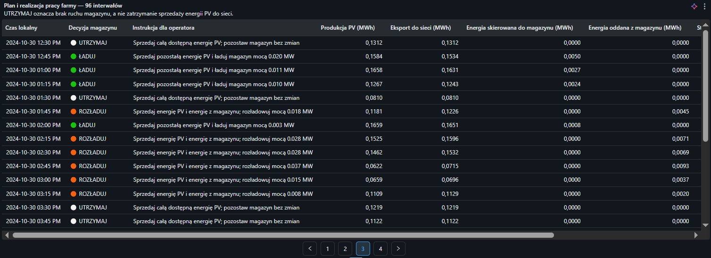

# PV Lakehouse Platform — Solar Farm Decision Support

**English** | [🇵🇱 Polski](README_PL.md)

A master's thesis implementation project at SGH Warsaw School of Economics (2026), titled *Design and Implementation of a Data Lakehouse Platform for Decision Support at a Photovoltaic Farm*.

## Project overview

This platform integrates photovoltaic (PV) production measurements, archived weather forecasts, and electricity market prices. It prepares data for generation forecasting, day-ahead market (DAM) scheduling, historical battery dispatch simulation, and an operator-facing dashboard.

A central design requirement is **point-in-time correctness**: historical decisions must use only information that would have been available when those decisions were made, rather than future observations.

This is an **analytical, historical backtesting project**, not a system controlling a real solar farm or battery.

## Data sources and scope

- **PVDAQ / OEDI (NREL):** measurements from an actual 893 kW DC PV installation in California.
- **Open-Meteo:** archived weather forecasts.
- **CAISO OASIS:** day-ahead market (DAM) and real-time market (FMM) prices used for scheduling and settlement.
- **Data period:** July–October 2024; **simulation period:** October 2024.
- Battery specifications are research assumptions, not specifications of a physical battery connected to the installation.

## Architecture and technology

**Databricks · PySpark · Spark SQL · Delta Lake · Unity Catalog · MLflow · Lakeflow Jobs**

The pipeline follows a medallion-style lakehouse architecture:

1. **Landing zone:** retrieve and retain source files and provenance information.
2. **Bronze:** parse source data and persist their tabular representations.
3. **Silver:** clean and validate records; standardize timestamps, units, and schemas.
4. **Gold:** integrate datasets and reconstruct what information was available at each historical decision point.
5. **Analytics and simulation:** forecasting, DAM scheduling, battery dispatch backtesting, and energy/financial settlement.
6. **Operator dashboard:** present decisions, energy flows, and results through Databricks SQL.

## Repository contents

The 16 notebooks are exported as Databricks `.py` notebooks (`# Databricks notebook source`).

| File | Purpose |
| --- | --- |
| `00_setup_project.py` | Initialize and check the project environment. |
| `01_ingest_nlr.py` | Ingest PV installation measurements. |
| `02_bronze_nlr.py` | Build the Bronze layer for PV measurements. |
| `03_silver_nlr.py` | Clean and standardize PV measurements. |
| `04_ingest_weather_forecasts.py` | Retrieve archived weather forecasts. |
| `05_silver_weather.py` | Prepare weather data for analysis. |
| `06_ingest_caiso_prices.py` | Retrieve CAISO market prices. |
| `07_bronze_caiso_prices.py` | Build the Bronze layer for electricity prices. |
| `08_silver_caiso_prices.py` | Prepare market prices for downstream analytics. |
| `09_gold_market_replay.py` | Integrate Gold datasets and reconstruct historical market information. |
| `10_gold_eda_and_time_split.py` | Exploratory analysis and chronological data split. |
| `11_baseline_forecasting_models.py` | Train and evaluate baseline forecasting models. |
| `12_day_ahead_schedule.py` | Generate a DAM sales schedule. |
| `13_battery_dispatch_backtest.py` | Simulate historical battery charging and discharging. |
| `14_business_results.py` | Calculate energy and financial outcomes. |
| `15_decision_support_system.py` | Prepare operator-facing decisions and recommendations. |
| `Panel operacyjny farmy fotowoltaicznej.lvdash.json` | Exported Databricks dashboard definition. |
| `manifest.mf` | Manifest included in the project export. |

## Workflow orchestration and YAML configuration

The GitHub repository also contains **two Lakeflow Jobs definitions in YAML** and a top-level **`databricks.yaml`** configuration:

- **Job 1 — Data preparation (notebooks 00–09):** environment setup, source ingestion, and Bronze/Silver/Gold processing.
- **Job 2 — Analytics and simulation (notebooks 10–15):** EDA, chronological splitting, forecasting, DAM scheduling, battery backtesting, and operator outputs.
- **`databricks.yaml`:** Databricks Asset Bundle configuration referencing the resource YAML files.

These YAML files describe workflows; committing them to GitHub does not itself deploy or schedule jobs. **Jobs were run manually** in this project. Notebook paths and workspace settings must match the target Databricks environment.

## Dashboard and example results

The repository includes `Panel operacyjny farmy fotowoltaicznej.lvdash.json`, an exported **Databricks SQL dashboard definition**. It presents battery decisions, energy flows, state of charge, and financial simulation outcomes. The JSON definition requires a Databricks workspace and the corresponding result tables to render as an interactive dashboard.

The four images below are **actual screenshots of the project's Databricks dashboard**, showing the historical simulation for **October 30, 2024**, at 15-minute resolution.

### 1. PV production vs. day-ahead schedule

**Interpretation:** The chart compares forecast PV energy, actual generation, and the planned DAM sales schedule. Actual generation varies throughout the day and deviates from both the forecast and schedule. These differences provide the context for the battery dispatch backtest; a market schedule is not a measurement of actual production.

### 2. Battery charging and discharging commands

**Interpretation:** Positive recommended power indicates charging; negative power indicates discharging; zero indicates no change. Alternating actions during PV production hours reflect the schedule-balancing rules and modeled battery constraints. These are **simulated commands**, not instructions sent to a physical device.

### 3. Energy flows during the selected day

**Interpretation:** The chart distinguishes direct PV-to-grid energy, PV energy used to charge the battery, battery-to-grid energy, and total grid export. It illustrates how dispatch decisions redistribute energy across individual 15-minute intervals.

### 4. Operator decision dashboard

**Interpretation:** The table displays local interval time, **HOLD / CHARGE / DISCHARGE** decisions (shown in Polish in the original dashboard), operator instructions, PV generation, grid export, and battery charging/discharging energy. The visible excerpt includes charging at 12:45 PM and discharging at 1:45 PM. The dashboard communicates simulated decisions; it does not operate equipment.

*Image source: original Databricks dashboard screenshots provided by the project author, October 30, 2024.*

## How to run

1. Set up a **Databricks workspace** with Spark/Delta capabilities and appropriate permissions for Unity Catalog, volumes, and table creation.
2. Import the `.py` files as Databricks notebooks, retaining their names and execution order.
3. Review `00_setup_project.py` for catalog, schema, storage paths, and permissions. Check external source configuration in the ingestion notebooks.
4. Execute notebooks **00–15** in order, corresponding to **00–09 (data preparation)** and **10–15 (analytics and simulation)**. The two YAML job definitions can also be used once paths and environment settings have been configured.
5. Once result tables exist, import the `.lvdash.json` dashboard definition and adapt SQL object names and connections for the workspace.
6. Review data-quality checks, data completeness, date ranges, and simulation outputs before interpreting results.

**Note:** This is not a standalone Python application runnable with `python`. The notebooks require a configured Databricks environment, input data, and access to relevant services. Environment-specific adjustments may be necessary.

## October 2024 simulation summary

For the October 2024 scenario balancing the PV energy sales schedule, the thesis presentation reports:

| Metric | Result |
| --- | ---: |
| PV generation | 109.11 MWh |
| Grid energy export | 109.15 MWh |
| Battery energy losses | approximately 0.36 MWh |
| Net operating revenue after battery degradation cost | USD 4,579.68 |
| Result after adjustment for ending battery energy inventory | USD 4,564.92 |

Battery energy inventory decreased from **0.50 MWh to 0.10 MWh**, which is reflected in the ending-inventory adjustment. These figures apply to **one simulated month** and the selected model parameters. **They do not establish investment profitability**: battery acquisition costs and some market charges were excluded.

## Limitations

- The platform processes a fixed historical dataset; it does not control devices or connect directly to SCADA/IoT.
- Forecast availability is reconstructed using an assumed fixed publication delay.
- Prices at a selected aggregation point approximate the farm's local prices.
- Settlement omits some real-market rules and charges.
- Validation checks consistency with project assumptions but does not establish the correctness of every source measurement.

## Future improvements

Potential extensions include scheduled ingestion and incremental table updates, handling late-arriving and corrected data, regular model retraining, separate schedules for forecasting/planning/settlement, and detailed inverter measurements, statuses, and error codes.

## Project documentation

This README is based on the master's thesis, defense presentation, and exported project code. The YAML configurations were created later in GitHub and were not part of the original ZIP export. The thesis, especially Chapter 3, documents the algorithms, assumptions, limitations, and validation in greater detail. Numerical results are taken from the defense presentation; they were not recomputed by rerunning the notebooks.
